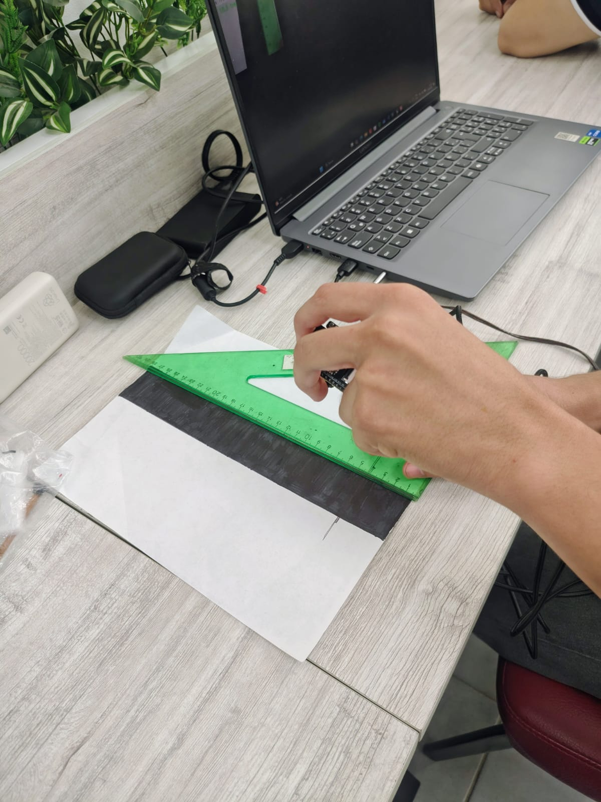
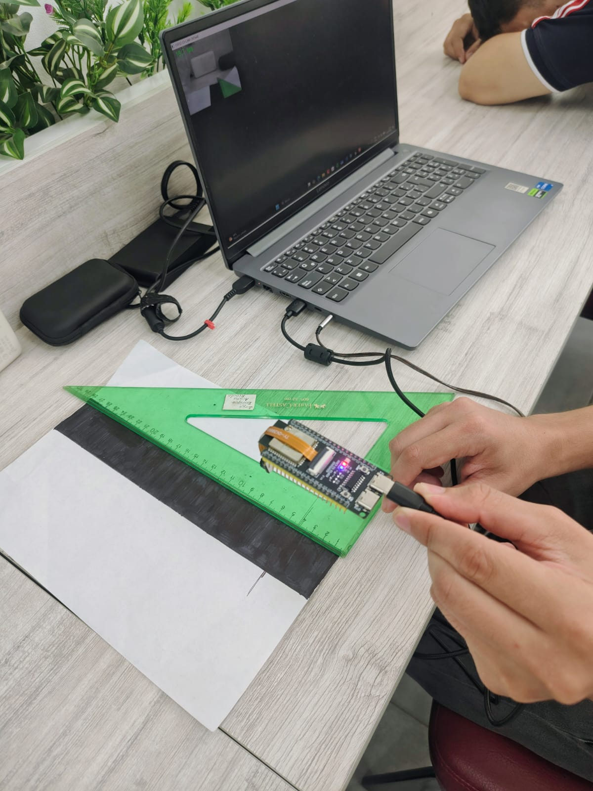
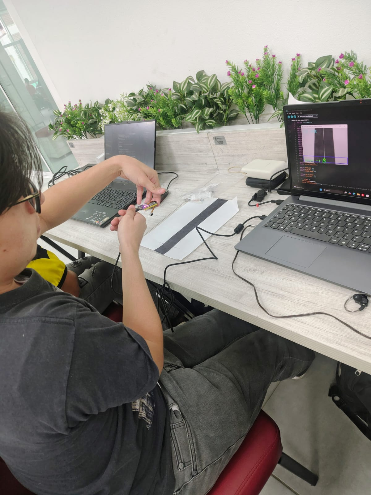
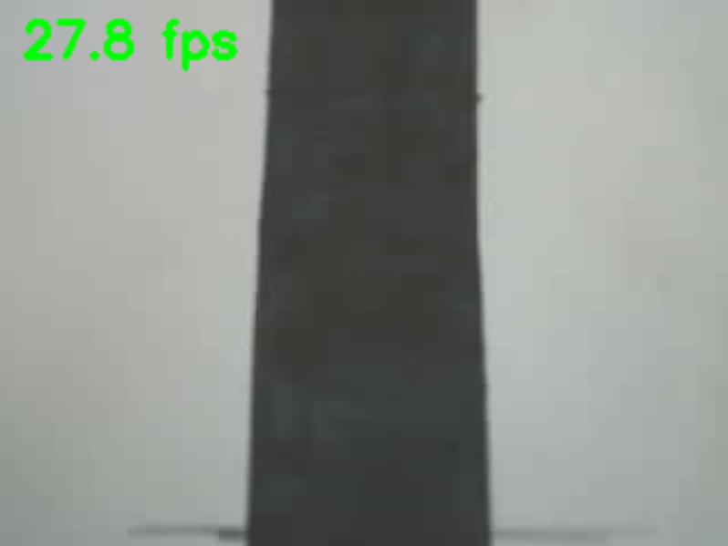
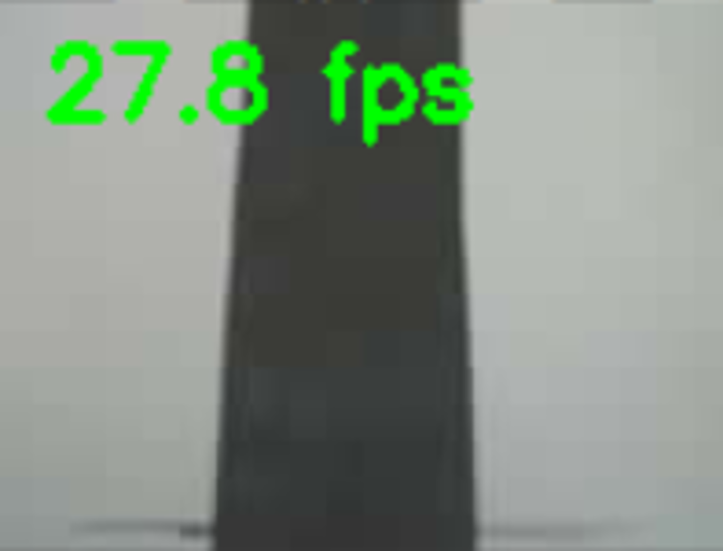
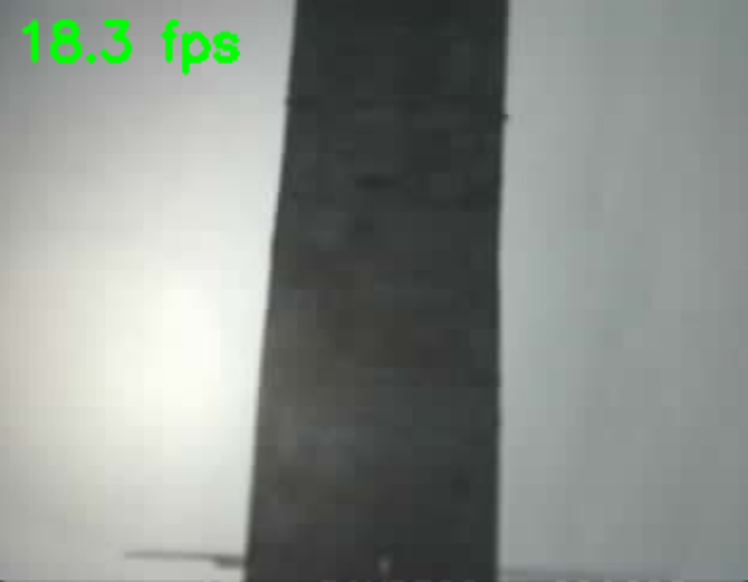
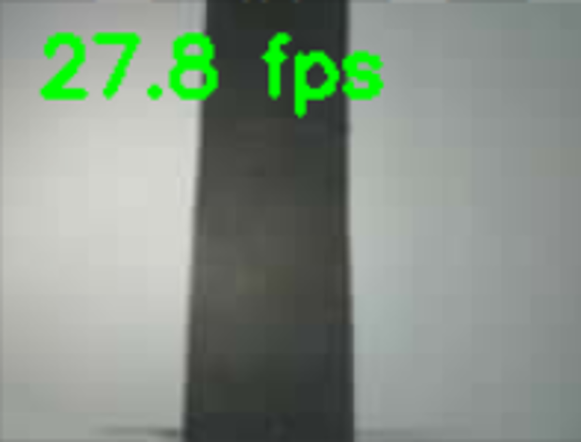

# Sensórica mediante ESPCAM
  
  **Autoria:** Juan Fernando Acuña Alba
> **Fecha ultima actualización:** [06/10/2026]    

---

## 1. Apartados base/iniciales
Se adquirió la ESP32S3 CAM y la ESPCAM para realizar las pruebas. 
Se inició por hacer una prueba de conexión con la cámara mediante conexión serial (Código: Prueba1), con la cual se trabajo a una resolución inicial de 320x240 pixeles, posterior a eso se realizo pruebas bajando la resolución a 160x120
Para finalizar se espejó la cámara en el eje Y con fines de practicidad al momento de incorporar a la estructura (Código: Prueba2)

---

## 2. Proceso de investigación y desarrollo relacionada al seguimiento de linea negra
### 2.1 Escenario y condiciones ambientales
Para poder realizar pruebas de las cámaras se procedió a imitar las caracteristicas de la pista (area blanca con una linea negra), para esto se utilizó una hoja blanca y mediante un marcador Sharpie negro se pintó una linea recta de 3 cm de grosor, tratando de obtener la consistenncia o profundidad del color que tendría la pista original. Posterior a esto se preparó varias fuentes de luz(natural, artificial controlada y artificial intensa), a partir de ubicaciones consisas dentro de la propia universidad (Biblioteca, laboratorio de ingeniería mecatrónica y plazoleta)

<figure align="center">
  
  <figcaption><b>Figura 1:</b> Prueba de cámara en biblioteca</figcaption>
</figure>

<figure align="center">
  
  <figcaption><b>Figura 2:</b> Prueba de cámara en biblioteca</figcaption>
</figure>

<figure align="center">
  
  <figcaption><b>Figura 3:</b> Prueba de cámara en biblioteca</figcaption>
</figure>

### 2.2 Determinar la configuración de la cámara
Se realizó un analisis de la carga de procesamiento en la placa de control (ESP32S3 CAM) respecto a la resolución y fluides de las imagenes provenientes de la camara. 
Se contrastaron 2 resoluciones, 320x240 y 160x120, las cuales fueron puestas a la misma altura (14cm) con la misma distancia de visión posible (10cm hacia el frente y 15cm de lado a lado). Al poner a observar a la cámara una linea negra (hecha con marcador sharpie en una hoja blanca) se obtiene que la segunda resolución se percibe menos detalles que la primera, lo cual es conveniente para nuestro objetivo, ya que al contar con menos cantidad de pixeles por área, va a ser más robusto ante cambios de iluminación o superficie(como la linea negra con sharpie, la cual el color no es uniforme), a su vez, la carga de procesamiento de las imagenes es 4 veces inferior que la resolución de 320x240.
A continuación una muestra del visual de la cámara respecto a la linea negra en condiciones de iluminación ambiental artificial (iluminación de biblioteca):

<figure align="center">
  
  <figcaption><b>Figura 4:</b> Resolución 320x240 sin linterna</figcaption>
</figure>

<figure align="center">
  
  <figcaption><b>Figura 5:</b> Resolución 160x120 sin linterna</figcaption>
</figure>

y iluminación mediante una linterna apuntando a la pista:

<figure align="center">
  
  <figcaption><b>Figura 6:</b> Resolución 320x240 con linterna</figcaption>
</figure>

<figure align="center">
  
  <figcaption><b>Figura 7:</b> Resolución 160x120 con linterna</figcaption>
</figure>

para determinar el angulo al que se posicióna la cámara respecto al piso para poder hacer la correcta visualización, se aplicaron fórmulas matemáticas las cuales serán detalladas en otro .mb, teniendo como resultado que el ángulo aproximado de inclinación ha e ser 30°

### 2.3 Lógica y desarrollo para la detección de linea negra
Para poder implementar detección de linea negra en la camara se realizó un código el cual aplica filtro en escala de grises y una linea recta delgada en el centro que indica una clara locacización de la linea negra real. El código constantemente va comparando el centro de la linea negra con la linea recta delgada de referencia, infiriendo así la diferencia de pixeles entre ambas. Esta comparativa se aplica en un área inicial cercana a la parte inferior, comprobando que su efectivad es bastante alta para ir ubicando la linea.

<figure align="center">
  
  <figcaption><b>Figura 8:</b> Detección de linea cuando está en el centro</figcaption>
</figure>

<figure align="center">
  
  <figcaption><b>Figura 9:</b> Detección de linea cuando está a la derecha</figcaption>
</figure>

<figure align="center">
  
  <figcaption><b>Figura 10:</b> Detección de linea cuando está a la izquierda</figcaption>
</figure>

La cámara, aunque precisa iba a menos de 5 fotogramas por segundo, para mejorar su fluidez se probó comprimiendo la imagen al momento de enviarse, y se probó detectando la linea mediante decodificación rapida del ROI. Como resultado se obtuvo que, aunque, si cumplió el objetivo de mejorar la tasa de fotogramas (+25 por segundo) su presición bajó notoriamente cuando la linea negra se encuentra cerca de los extremos (debido a que el metodo de detección objetivamente es inferior al de escala de grises)

<figure align="center">
  
  <figcaption><b>Figura 11:</b> Detección de linea cuando está centrada</figcaption>
</figure>

<figure align="center">
  
  <figcaption><b>Figura 12:</b> Detección de linea cuando está a la derecha</figcaption>
</figure>

<figure align="center">
  
  <figcaption><b>Figura 13:</b> Detección de linea cuando está a la izquierda</figcaption>
</figure>

Como tercera prueba se implementó un filtrado en escala de grises pero mandando la información de forma comprimida, y con esto se obtuvieron mejores resultados, la ubicación del centroide ya no iba con retraso y fue mas precisa, siendo este ultimo el proceso seleccionado para la identificación de la linea.

<figure align="center">
  
  <figcaption><b>Figura 14:</b> Detección de linea cuando está centrado</figcaption>
</figure>

<figure align="center">
  
  <figcaption><b>Figura 15:</b> Detección de linea cuando está a la derecha</figcaption>
</figure>

<figure align="center">
  
  <figcaption><b>Figura 16:</b> Detección de linea cuando está a la izquierda</figcaption>
</figure>

### 2.4 Implementación de orientación y predicción
Ya con la detección de linea negra implementada, se procedió a clasificar de acuerdo a la diferencia de pixeles la ubicación de la linea(izquierda, derecha o centro):

<figure align="center">
  
  <figcaption><b>Figura 17:</b> Detección de linea cuando está centrado</figcaption>
</figure>

<figure align="center">
  
  <figcaption><b>Figura 18:</b> Detección de linea cuando está a la derecha</figcaption>
</figure>

<figure align="center">
  
  <figcaption><b>Figura 19:</b> Detección de linea cuando está a la izquierda</figcaption>
</figure>

Posterior a conseguirlo, se implementó un tipo de "predicción", el cual consiste en que la camara no solo vaya analizando la parte cercana, sino tambien 2 cuadros alfrente (Dos ROI diferentes adicionales al frente), los cuales tambien irán ubicando el centroide de la linea, así consiguiendo que el microcontrolador ya tenga conocimiento de si la linea se curva o sigue derecho de forma más certera

<figure align="center">
  
  <figcaption><b>Figura 20:</b> detección triple de linea centrado</figcaption>
</figure>

<figure align="center">
  
  <figcaption><b>Figura 21:</b> Detección triple de linea cuando está a la derecha</figcaption>
</figure>

<figure align="center">
  
  <figcaption><b>Figura 22:</b> Detección triple de linea diagonal</figcaption>
</figure>
---

## 3. Implementación por partes del código embebido
### 3.1 Implementación del código de detección de linea en embebido
Se modificó el código .INO de detección de linea, integrando las funciones que realizaba el código python, de manera que toda la toma de imagen, procesamiento y resultado quedará embebido en la tarjeta ESP32S3 CAM, para comprobar su funcionalidad, se programó que la diferencia de pixeles que andaba visualizando la camara entre la linea negra real y la linea de referencia fuera impresa en el serial, con la cual al realizar pruebas empiricas se visualizó una precisión acertada (hasta donde se podia comprobar con solo la ESP32S3 y la ESPCAM)